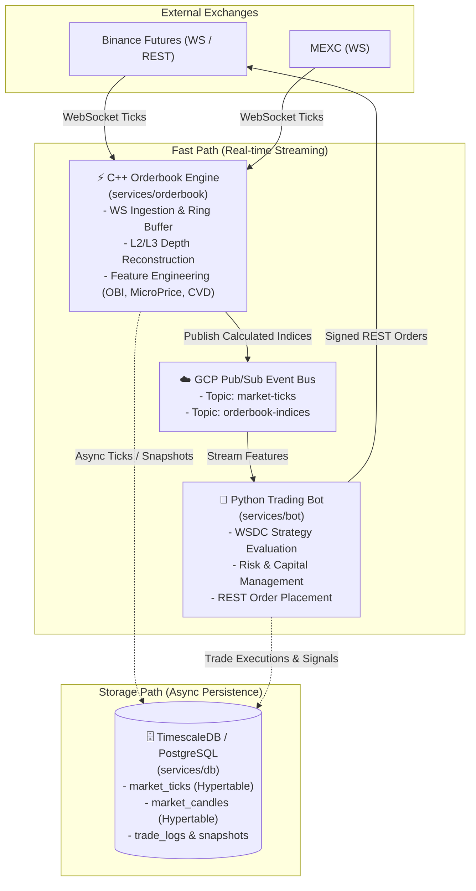

# 🚀 AutoCryptoTrading System

[]()
[](LICENSE)
[](https://isocpp.org/)
[](https://www.python.org/)
[](https://www.timescale.com/)
[](https://cloud.google.com/pubsub)
[](https://www.docker.com/)

> [!NOTE]
> **Project Status: Work in Progress (WIP)**  
> This project is currently under active development. The system is being architected and built to target a modular, multi-container microservice design separated into dedicated C++, Python, and Database containers.

**AutoCryptoTrading** is an algorithmic cryptocurrency trading system actively being developed to target high-frequency market data ingestion, ultra-low-latency Limit Order Book (LOB) depth reconstruction, quantitative signal consensus (WSDC strategy), and robust time-series persistence.

---

## 🎯 Target Architecture

The target system separates data processing into a **Fast Path (Real-time Event Stream)** and a **Storage Path (Asynchronous Persistence)** to maximize throughput and eliminate latency bottlenecks in trade execution.



---

## 🧩 Target Roles & Responsibilities

| Component | Target Tech Stack | Planned Responsibilities | Architectural Rationale |
| :--- | :--- | :--- | :--- |
| **⚡ C++ Engine** (`orderbook/`) | C++20, CMake, `ixwebsocket`, `spdlog` | • Ingest high-frequency WebSocket tick streams<br/>• Reconstruct real-time L2/L3 Limit Order Books in memory<br/>• **Compute mathematical market indices** (Order Book Imbalance, Micro-price, CVD, short-term rolling averages) | Garbage-collection-free, sub-millisecond execution; prevents raw JSON tick floods from bottlenecking Python |
| **☁️ GCP Pub/Sub** | Google Cloud Pub/Sub | • Decoupled event-driven message broker<br/>• Topics: `market-ticks`, `orderbook-indices`, `trade-signals` | Decouples C++ and Python lifecycles; enables multi-subscriber fan-out (DB logging, monitoring) without changing C++ code |
| **🤖 Python Bot** (`bot/`) | Python 3.10, NumPy, Pandas | • **WSDC (Weighted Signal Density & Consensus) decision brain**<br/>• Portfolio risk management, position sizing & leverage control<br/>• Signed REST API order dispatch & fill tracking<br/>• Real-time Telegram trade alerts | High-level business logic agility, seamless strategy parameter tuning, and backtesting parity |
| **🗄️ Database** (`db/`) | TimescaleDB (PostgreSQL 15) | • Time-series persistence for ticks & OHLCV candles<br/>• Periodic L2 orderbook depth snapshots<br/>• Trade execution history & performance analytics | Asynchronous persistence completely off the critical trading path, eliminating database I/O lag |

---

## 📁 Repository & Directory Layout

The root repository serves as the **parent container orchestrator**, linking microservices as independent Git submodules.

```text
AutoCryptoTrading/
├── 📄 docker-compose.yml       # Multi-container orchestration (bot, orderbook, db)
├── 📄 .env.example              # Environment variables template
├── 📄 .gitmodules               # Git submodule definitions
├── 📄 LICENSE                   # MIT License
├── 📄 README.md                 # System architecture & documentation
│
├── 🤖 bot/                      # [Git Submodule] Python Trading Bot
│   ├── 📄 Dockerfile            # Python 3.10 runtime container
│   ├── 📂 src/                  # WSDC strategy, trade manager, order dispatch
│   └── 📂 test/                 # Pytest test suite
│
├── ⚡ orderbook/                # [Git Submodule] C++20 Order Book Engine
│   ├── 📄 Dockerfile            # Multi-stage C++ build container
│   ├── 📄 CMakeLists.txt        # CMake build configuration
│   ├── 📂 include/              # OrderBook, RingBuffer & WebSocket headers
│   └── 📂 src/                  # Engine core & exchange gateways
│
└── 🗄️ db/                       # [Git Submodule] Database Service
    ├── 📄 Dockerfile            # Custom TimescaleDB image configuration
    └── 📂 init/
        └── 📄 01_init_schema.sql# Hypertables (market_ticks, market_candles, trade_logs)
```

---

## ⚡ Getting Started

### 1. Clone with Submodules
```bash
git clone --recurse-submodules https://github.com/JoohanJin/crypto-auto-trading-bot.git
cd crypto-auto-trading-bot
```

### 2. Configure Environment Variables
```bash
cp .env.example .env
# Edit .env with your Exchange API keys, DB credentials, and Telegram tokens
```

### 3. Launch System Containers
```bash
docker compose up -d --build
```

### 4. Monitor Container Status & Logs
```bash
# Check container status
docker compose ps

# Stream all logs
docker compose logs -f

# Inspect individual service logs
docker compose logs -f orderbook
docker compose logs -f bot
docker compose logs -f db
```

---

## 🛠️ Git Submodule Workflow

Each service directory (`bot/`, `orderbook/`, `db/`) is an independent Git repository.

1. **Working inside a Submodule**:
   - Navigate to the component directory, ensure you are on `main`, commit, and push:
   ```bash
   cd orderbook
   git checkout main
   git add . && git commit -m "feat: add orderbook imbalance calculation"
   git push origin main
   ```

2. **Updating the Parent Orchestrator**:
   - Return to root, stage the updated submodule pointers, and push:
   ```bash
   cd ..
   git add orderbook
   git commit -m "chore: update orderbook submodule reference"
   git push origin dev
   ```

---

## 📄 License

This project is licensed under the MIT License - see the [LICENSE](LICENSE) file for details.
